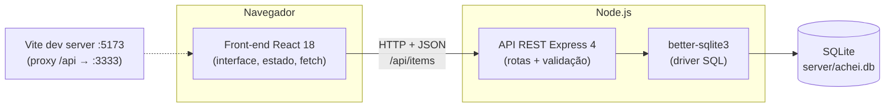

# Achei! — Sistema de Perdidos e Encontrados

Projeto acadêmico (prova de conceito) da disciplina de Laboratório de Engenharia de Software — FATEC Praia Grande.

## Descrição
Aplicação web para centralizar o registro e a consulta de objetos perdidos e encontrados em um ambiente institucional, como uma faculdade.

## Objetivo
Facilitar o cadastro, a pesquisa e o acompanhamento do status de objetos até a devolução.

## Tecnologias
- React 18 + Vite (front-end)
- Node.js + Express (API REST)
- SQLite via `better-sqlite3` (banco)
- CSS responsivo

## Funcionalidades
- Cadastrar objeto perdido ou encontrado, com validação.
- Listar registros, pesquisar por nome, categoria ou local.
- Filtrar por tipo e por status.
- Ver detalhes, atualizar status (Aberto, Em contato, Devolvido) e excluir.
- Persistência em SQLite, com registros de exemplo na primeira execução.

## Arquitetura
Cliente–servidor: **React** (navegador) ⇄ HTTP/JSON ⇄ **Express** ⇄ **SQLite**.



Demais diagramas (casos de uso, MER, componentes, sequência): [docs/diagramas.md](docs/diagramas.md).

## Estrutura de pastas
```
server/index.js     API REST + banco
src/                interface React
tests/              testes automatizados da API
docs/               documentação, diagramas e material da apresentação
```

## Pré-requisitos
Node.js 18 ou superior e npm (`node -v`). O `better-sqlite3` usa módulo nativo; se a instalação falhar, confira a versão do Node.

## Instalação
```
npm install
```

## Como executar
```
npm run dev
```
Interface: http://localhost:5173 · API: http://localhost:3333/api/health
O banco `server/achei.db` é criado automaticamente na primeira execução (e não é versionado).

Modo único (produção local): `npm run build` e depois `npm start` → http://localhost:3333.

## Como testar
```
npm test
```
Sobe o servidor com um banco temporário (porta 3399) e executa 13 casos de teste da API. Os testes manuais da interface e a situação da execução estão em [docs/plano-de-testes.md](docs/plano-de-testes.md).

## Endpoints
| Método | Caminho | Finalidade |
|---|---|---|
| GET | `/api/items?q=&kind=&status=` | listar/pesquisar/filtrar |
| POST | `/api/items` | cadastrar |
| PATCH | `/api/items/:id/status` | atualizar status |
| DELETE | `/api/items/:id` | excluir |
| GET | `/api/health` | verificar a API |

Detalhes (corpo, respostas, erros): [docs/api.md](docs/api.md).

## Banco de dados
Uma tabela, `items` (id, title, category, kind, location, date, description, contact, status, created_at). Dicionário completo: [docs/dicionario-dados.md](docs/dicionario-dados.md).

## Documentação
[Requisitos](docs/requisitos.md) · [Casos de uso](docs/casos-de-uso.md) · [Diagramas](docs/diagramas.md) · [Modelo de dados](docs/modelo-dados.md) · [Arquitetura e documentação técnica](docs/arquitetura.md) · [Plano de testes](docs/plano-de-testes.md)

## Limitações
Sem autenticação nem perfis (qualquer pessoa pode excluir), sem upload de imagens, notificações ou histórico de status. Uma única entidade no banco. Não deve receber dados pessoais reais. Melhorias futuras estão em [docs/arquitetura.md](docs/arquitetura.md).
