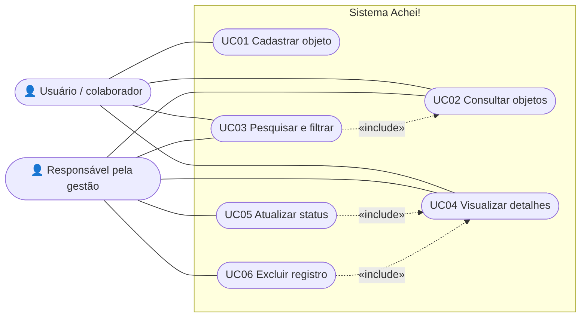

# Casos de Uso — Achei!

**Atores.** *Usuário/colaborador* (cadastra e consulta) e *Responsável pela gestão* (acompanha, atualiza status e remove registros).
Nesta prova de conceito **não há autenticação**: na interface, qualquer pessoa executa qualquer caso de uso. Os dois atores representam papéis de uso, não perfis de acesso implementados.

Pré-condição comum: a API está em execução e o banco SQLite está acessível.

## UC01 — Cadastrar objeto
- **Ator:** Usuário.
- **Requisitos:** RF01, RF02 · **Regras:** RN01, RN02, RN04, RN06, RN07
- **Fluxo principal:**
  1. O usuário clica em "Novo registro".
  2. O sistema exibe o formulário (nome, categoria, tipo, local, data, descrição, contato).
  3. O usuário preenche e clica em "Salvar registro".
  4. O sistema valida os dados, grava o registro com status "Aberto" e exibe a confirmação.
  5. A lista é recarregada com o novo registro.
- **Fluxo alternativo A (dados inválidos):** no passo 4 o sistema responde 400, mostra a mensagem de erro e mantém o formulário aberto.
- **Fluxo alternativo B (API indisponível):** o sistema exibe mensagem de erro e nada é gravado.
- **Pós-condição:** novo registro persistido no SQLite.

## UC02 — Consultar objetos
- **Ator:** Usuário, Responsável. · **Requisito:** RF03
- **Fluxo principal:** ao abrir a página, o sistema consulta `GET /api/items` e exibe os registros em cartões, do mais recente ao mais antigo, com os totais no topo.
- **Alternativo:** sem registros, exibe "Nenhum registro encontrado". Com a API fora do ar, exibe aviso de conexão.

## UC03 — Pesquisar e filtrar
- **Ator:** Usuário, Responsável. · **Requisitos:** RF04, RF05 · **Regra:** RN05
- **Fluxo principal:** o usuário digita um termo e/ou escolhe tipo e status; a cada mudança o sistema consulta a API com `q`, `kind` e `status` e atualiza a lista.
- **Alternativo:** nenhum resultado → mensagem de lista vazia.

## UC04 — Visualizar detalhes
- **Ator:** Usuário, Responsável. · **Requisito:** RF06
- **Fluxo principal:** o usuário clica em um cartão; o sistema abre a janela com tipo, categoria, local, data, contato, status e descrição.

## UC05 — Atualizar status
- **Ator:** Responsável. · **Requisito:** RF07 · **Regras:** RN02, RN03
- **Fluxo principal:** em UC04, o ator escolhe Aberto, Em contato ou Devolvido; o sistema envia `PATCH`, grava o novo status, recarrega a lista e informa "Status atualizado."
- **Alternativo:** registro inexistente (404) ou status inválido (400) → mensagem de erro, nada é alterado.

## UC06 — Excluir registro
- **Ator:** Responsável. · **Requisito:** RF08 · **Regra:** RN03
- **Fluxo principal:** em UC04, o ator clica em "Excluir registro" e confirma; o sistema envia `DELETE`, remove o registro e recarrega a lista.
- **Alternativo:** o ator cancela a confirmação → nada acontece. Registro inexistente → 404.
