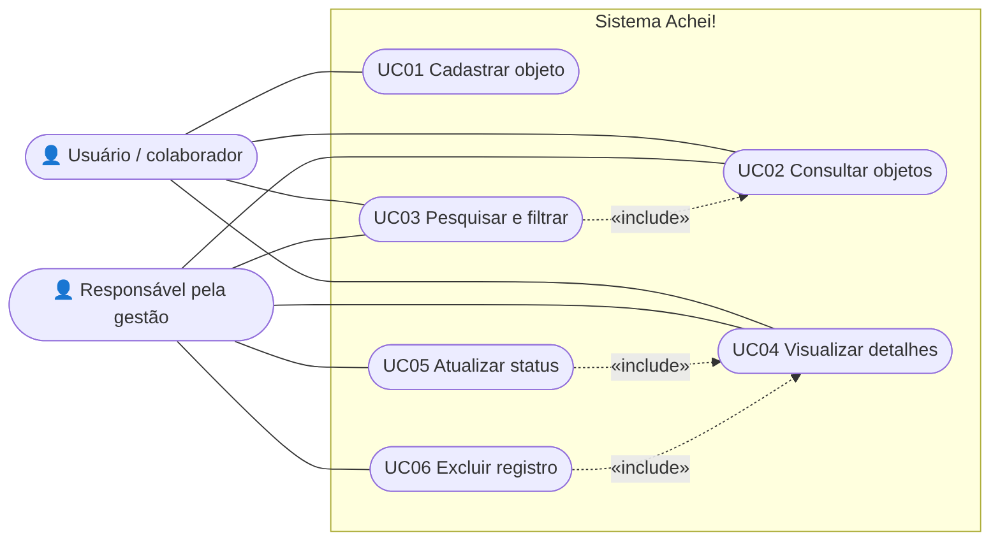
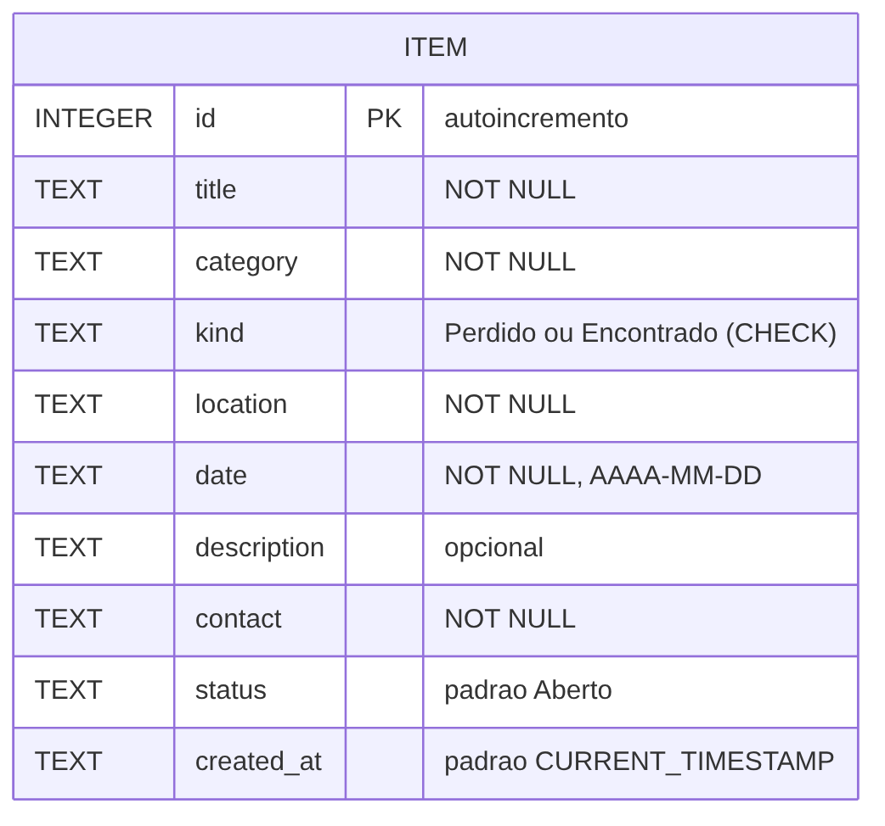
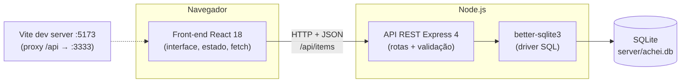
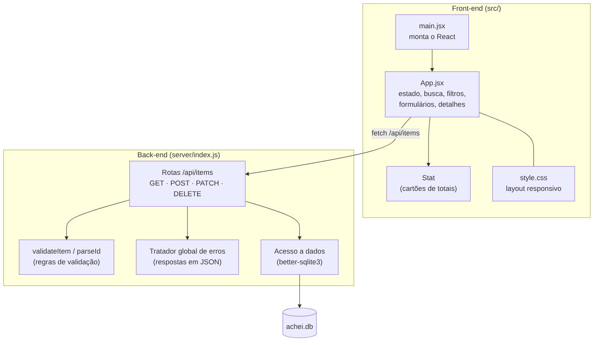
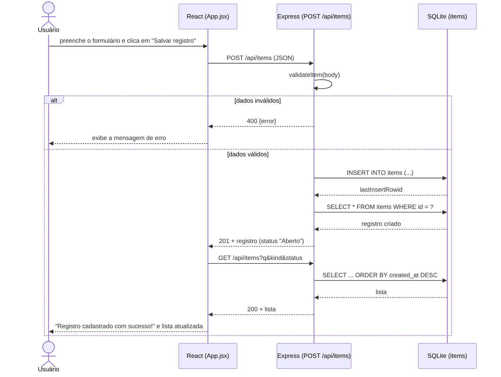
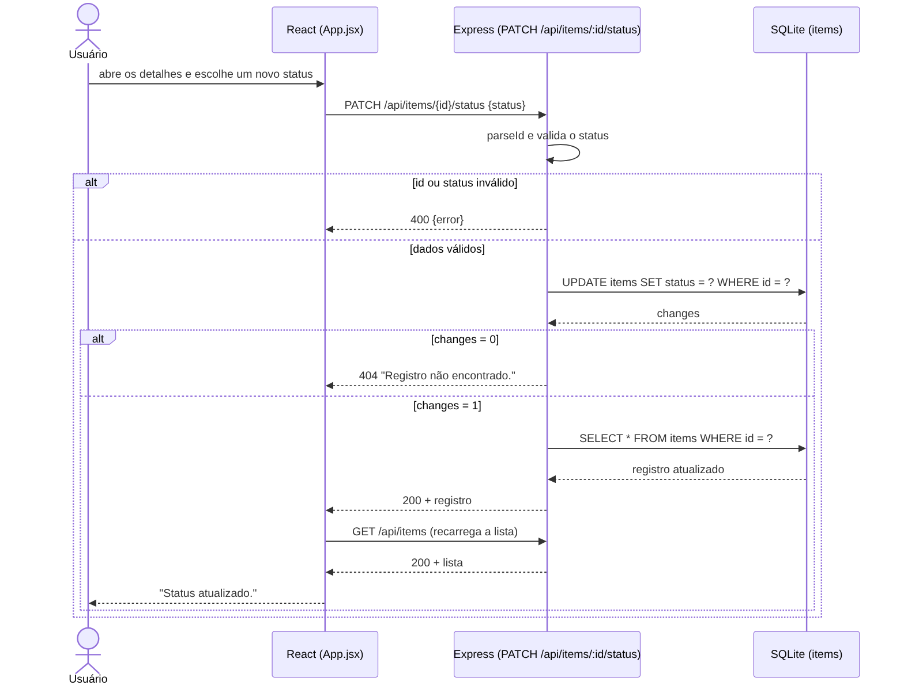

# Diagramas técnicos — Achei!

Os códigos-fonte (Mermaid) estão em `docs/diagramas/*.mmd`; as imagens `.png` foram exportadas a partir deles.
Para regerar: `mmdc -i docs/diagramas/NOME.mmd -o docs/diagramas/NOME.png -b white -s 2`.

## 1. Casos de uso
 — detalhamento em [casos-de-uso.md](casos-de-uso.md).

## 2. MER (Modelo Entidade-Relacionamento)

O sistema implementado possui **uma única entidade (ITEM)**; por isso não há relacionamentos. Entidades como `Usuario`, `Instituicao` e `HistoricoStatus` são **evolução futura**, não fazem parte da implementação.

## 3. Arquitetura

Cliente–servidor em três partes lógicas: interface (React), API REST (Express) e dados (SQLite).

## 4. Componentes

## 5. Sequência — cadastrar objeto

## 6. Sequência — atualizar status

## 7. Diagrama de classes — não aplicável
O back-end é composto por funções e rotas (sem classes de domínio) e o front-end usa componentes funcionais do React. Com uma única entidade e sem orientação a objetos no código, um diagrama de classes não acrescentaria informação além do MER, e o enunciado pede-o apenas "se for adequado". O MER cobre a modelagem de dados.
