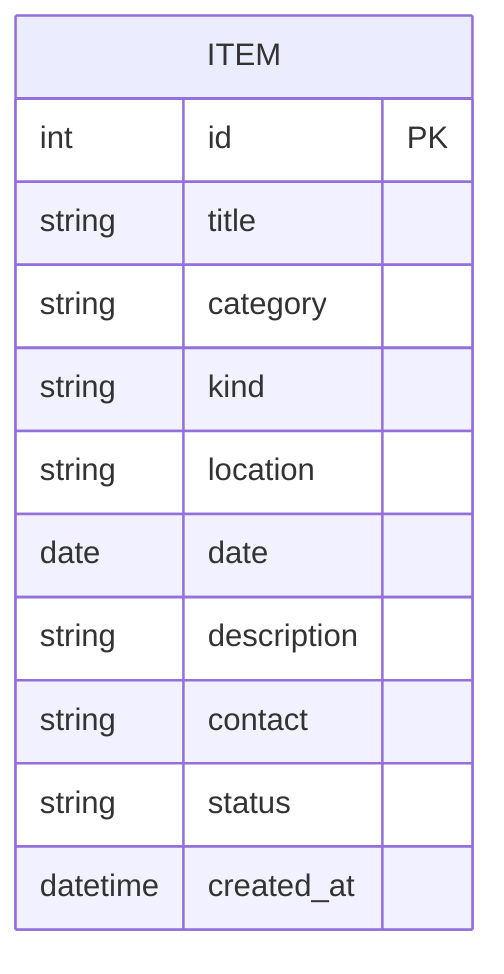
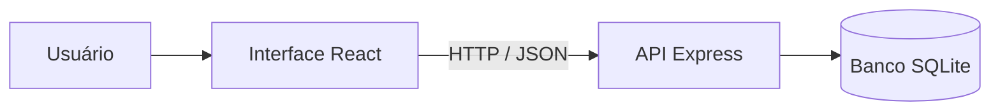

# Modelo de Dados — Achei!

## Entidade: Item
| Campo | Tipo | Regra |
|---|---|---|
| id | INTEGER | Chave primária, autoincremento |
| title | TEXT | Obrigatório |
| category | TEXT | Obrigatório |
| kind | TEXT | Perdido ou Encontrado |
| location | TEXT | Obrigatório |
| date | TEXT | Data do registro do fato |
| description | TEXT | Opcional |
| contact | TEXT | Obrigatório |
| status | TEXT | Aberto, Em contato ou Devolvido |
| created_at | TEXT | Data/hora de criação |

## Relacionamentos
A PoC atual utiliza uma única entidade (`Item`), portanto não há relacionamentos entre tabelas. Em uma evolução, podem ser criadas entidades `Usuario`, `Instituicao` e `HistoricoStatus`, relacionando cada item ao usuário responsável e à instituição.

## Diagrama ER (versão implementada)

## Arquitetura

